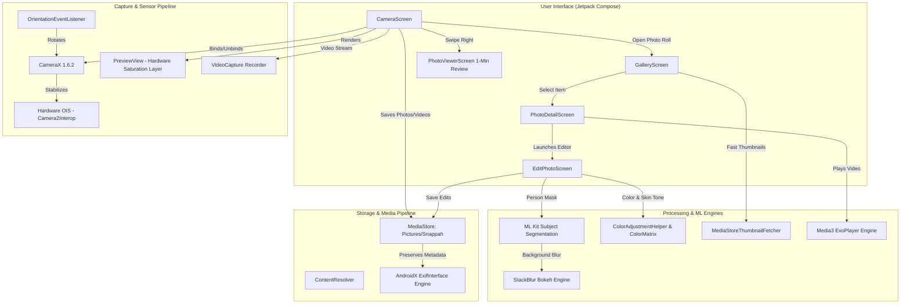

#  Snappah

A minimal, distraction-free point-and-shoot camera app for Android built with **Jetpack Compose** and **CameraX**, featuring an integrated media gallery and pro photo editor powered by **Google ML Kit** and **Media3 ExoPlayer**.

Snappah combines the speed and simplicity of classic point-and-shoot photography with modern Android imaging capabilities. Frame your shot on a clean viewfinder with hardware Optical Image Stabilization (OIS) and real-time saturation enhancement, capture photos or record videos instantly, and jump straight into a full-featured media roll and advanced editing suite without leaving the app.

## Installation

Pre-built APKs are published to GitHub Releases at https://github.com/cfegela/snappah/releases. Follow the step-by-step instructions below to install release **26.10.14**.

### Option 1: Direct Install on Android Device

1. **Download the APK**: Navigate to [GitHub Releases](https://github.com/cfegela/snappah/releases) (or the [v26.10.14 Release](https://github.com/cfegela/snappah/releases/tag/v26.10.14)) on your device browser and download [`Snappah-v26.10.14.apk`](https://github.com/cfegela/snappah/releases/download/v26.10.14/Snappah-v26.10.14.apk).
2. **Allow Installation from Unknown Sources**: Tap the downloaded APK in your notification shade or Downloads folder. If prompted with a security dialog, tap **Settings** and enable **Allow from this source** (or navigate to **Settings** → **Apps** → **Special app access** → **Install unknown apps**).
3. **Install the App**: Return to the installer prompt and tap **Install**.
4. **Grant Permissions**: Once installed, tap **Open** and approve the required permissions (Camera, Microphone, and Photos/Storage) when prompted.

### Option 2: Install via ADB (Computer)

1. **Download the APK**:
   ```bash
   curl -LO https://github.com/cfegela/snappah/releases/download/v26.10.14/Snappah-v26.10.14.apk
   ```
2. **Connect Device**: Connect your Android device to your computer via USB with **USB debugging** enabled.
3. **Install the APK**:
   ```bash
   adb install -r Snappah-v26.10.14.apk
   ```

## Technical Architecture



### 1. Camera & Sensor Pipeline
- **Lifecycle-Aware Binding**: `ProcessCameraProvider` binds `Preview`, `ImageCapture`, and `VideoCapture<Recorder>` simultaneously to the Compose lifecycle.
- **Hardware Optical Image Stabilization (OIS)**: Inspects `CameraCharacteristics.LENS_INFO_AVAILABLE_OPTICAL_STABILIZATION` via `Camera2CameraInfo`. When available, applies `CaptureRequest.LENS_OPTICAL_STABILIZATION_MODE_ON` via `Camera2Interop` to both `ImageCapture` and the continuous repeating viewfinder session.
- **Resource Management**: When switching from camera to gallery, `CameraScreen` explicitly calls `provider.unbindAll()` and releases the camera session, ensuring zero battery drain and complete hardware sensor release while browsing media.
- **High-Quality Still Capture**: Configured with `ImageCapture.CAPTURE_MODE_MAXIMIZE_QUALITY`, engaging ISP Multi-Frame Noise Reduction (MFNR) and zero-shutter-lag algorithms.
- **Native 3:4 Viewfinder**: Matches the physical aspect ratio of the camera sensor with pure OLED black letterboxing to prevent sensor cropping.
- **Dynamic Orientation Mapping**: Monitors device accelerometer tilt via `OrientationEventListener`, mapping angles to `Surface.ROTATION_*` constants and updating target rotation at capture time to write proper EXIF orientation tags.

### 2. WYSIWYG Color & Processing Pipeline
- **Real-Time Saturation Filter**: Applies a calibrated 15% saturation enhancement (`SATURATION_BOOST = 1.15f`) across both the viewfinder and final JPEG file.
- **Hardware-Accelerated Viewfinder**: Viewfinder saturation is applied via `ColorMatrixColorFilter` directly on the `PreviewView` hardware layer (`View.LAYER_TYPE_HARDWARE`), consuming zero CPU.
- **Post-Capture Processing**:
  - Image captured to a temporary cache file via CameraX.
  - Decoded and rendered to an in-memory bitmap with matching `ColorMatrixColorFilter`.
  - Compressed to JPEG at 98% quality into `Pictures/Snappah/SNAP_<timestamp>.jpg` using scoped `MediaStore`.
  - Full EXIF metadata copied from original capture (`TAG_EXPOSURE_TIME`, `TAG_F_NUMBER`, `TAG_ISO_SPEED_RATINGS`, `TAG_FLASH`, `TAG_FOCAL_LENGTH`, GPS coordinates, timestamps, device make/model).

### 3. Integrated Gallery & High-Speed Thumbnail Pipeline
- **Custom Coil Thumbnail Fetcher**: `MediaStoreThumbnailFetcher` hooks into Coil's image loading pipeline. For thumbnail requests on Android 10+ (API 29+), it delegates to `ContentResolver.loadThumbnail()` with a target size of 360×360 px, reading pre-generated OS thumbnails with zero decode latency.
- **Video Playback Engine**: Embedded `Media3 ExoPlayer` renders video playback within Compose via `AndroidView` wrapping `PlayerView`, with custom UI controls for play/pause and state tracking.
- **Scoped Media Operations**: Media queries target both `Pictures/Snappah/` and legacy `Pictures/simplah/` directories across both images and videos.

### 4. ML Kit Subject Segmentation & Portrait Blur Engine
- **Subject Segmentation**: Leverages Google ML Kit Subject Segmentation (`SubjectSegmentation.getClient()`) to generate high-resolution subject masks separating people from backgrounds.
- **Creamy Bokeh Synthesis**: Downscales masks to an optimized processing buffer (512px max dimension) and executes a high-speed multi-pass `StackBlur` algorithm. The blurred background is composited with the crisp foreground using `PorterDuff.Mode.DST_OVER` and `PorterDuff.Mode.SRC_IN` xfermodes.
- **Mask Caching**: Keeps a `WeakReference` to the active source bitmap and mask, allowing users to scrub between bokeh blur intensity levels (1–5) in real time without re-running ML inference.

### 5. Color Adjustment & Tone Engine
- **Skin-Tone Protection Algorithm**: Built inside `ColorAdjustmentHelper`, computes color transformation matrices that specifically lower warm/red complexion saturation (`sr = 1.0 - reduction`, `sg = 1.0 - reduction * 0.20`, `sb = 1.0`) while preserving luminance weights (`wr = 0.2126`, `wg = 0.7152`, `wb = 0.0722`). Neutral grays and non-skin channels (skies, greens) remain untouched.
- **Tonal Curves**: Multi-stage matrix concatenation dynamically combines exposure lift, black-point deepening, uniform saturation, skin-tone reduction, and film preset matrices into a single unified `ColorMatrixColorFilter`.

## Tech Stack

| Layer | Technology | Purpose |
| :--- | :--- | :--- |
| **Language** | Kotlin (JVM target 17) | Modern Android application logic |
| **UI Framework** | Jetpack Compose + Material 3 (BOM `2024.10.01`) | Declarative reactive user interface |
| **Camera Core** | AndroidX CameraX `1.6.2` | Camera preview, still capture, and video recording |
| **Camera2 Extensions** | AndroidX `camera-camera2` | Hardware OIS control via `Camera2Interop` |
| **Image Loading** | Coil `2.7.0` (`coil-compose`, `coil-video`) | Asynchronous image & video thumbnail loading |
| **Video Player** | AndroidX Media3 ExoPlayer `1.4.1` | High-performance in-app video playback |
| **ML & Segmentation** | Google ML Kit Subject Segmentation `16.0.0-beta1` | On-device subject isolation for portrait bokeh |
| **Metadata Handling** | AndroidX ExifInterface `1.3.7` | Non-destructive EXIF reading and writing |
| **Audio Synthesis** | `SoundPool` · `ToneGenerator` | Shutter sound effects and recording start/stop cues |
| **Build System** | Gradle `8.11.1` · AGP `8.9.1` | Android build and packaging |

### Target SDK Specifications

| Property | Value | Platform |
| :--- | :--- | :--- |
| `minSdk` | **26** | Android 8.0 (Oreo) |
| `targetSdk` | **36** | Android 16 (Baklava) |
| `compileSdk` | **36** | Android 16 (Baklava) |

## Permissions & Storage Model

| Permission | Scope | Technical Purpose |
| :--- | :--- | :--- |
| `CAMERA` | Runtime | Viewfinder stream, auto-focus metering, and photo capture |
| `RECORD_AUDIO` | Runtime | Synchronous audio track for video recordings |
| `READ_MEDIA_IMAGES` | Runtime (`minSdk 33`) | Accessing photos in MediaStore on Android 13+ |
| `READ_MEDIA_VIDEO` | Runtime (`minSdk 33`) | Accessing videos in MediaStore on Android 13+ |
| `READ_MEDIA_VISUAL_USER_SELECTED` | Runtime (`minSdk 34`) | Supporting Android 14+ Partial Media Access consent |
| `READ_EXTERNAL_STORAGE` | Runtime (`maxSdk 32`) | Accessing photos/videos on Android 12 and below |
| `WRITE_EXTERNAL_STORAGE` | Runtime (`maxSdk 29`) | Legacy disk write fallback on Android 8.0–9.0 |
| `MANAGE_EXTERNAL_STORAGE` / `MANAGE_MEDIA` | System / Scoped | In-place image editing and scoped media management |
| `ACCESS_MEDIA_LOCATION` | Runtime | Preserving GPS coordinates across photo saves and edits |

- **Scoped Storage**: Photos are saved to `Pictures/Snappah/SNAP_<timestamp>.jpg` and videos to `Pictures/Snappah/SNAP_VID_<timestamp>.mp4` via `MediaStore` using `RELATIVE_PATH` and `IS_PENDING` flags, maintaining compatibility with both modern scoped storage and legacy systems.


## Compatibility

Snappah supports physical Android devices operating on API 26 (Android 8.0) through API 36 (Android 16):

- **Google Pixel**: Pixel 2 through Pixel 10 (Pro, XL, Fold, a-series)
- **Samsung Galaxy**: S-series (S8 through S25), Z Fold / Flip series, Note series, A-series
- **OEM Compatibility**: Motorola, OnePlus, Xiaomi, Nothing Phone, Sony Xperia, Asus, Oppo, Vivo


## Project Structure

```text
snappah/
├── app/
│   ├── src/
│   │   ├── main/
│   │   │   ├── AndroidManifest.xml                  # Hardware permissions, camera features, and queries
│   │   │   ├── java/
│   │   │   │   ├── com/example/snappah/
│   │   │   │   │   ├── MainActivity.kt              # Edge-to-edge layout, permissions, and app entry
│   │   │   │   │   ├── SnappahApp.kt                # Application class & custom Coil ImageLoader
│   │   │   │   │   └── ui/
│   │   │   │   │       ├── CameraScreen.kt          # CameraX pipeline, OIS, shutter, and letterboxing
│   │   │   │   │       ├── PhotoViewerScreen.kt     # 1-minute recent review stream and deletion
│   │   │   │   │       └── theme/                   # Snappah color palette, typography, and dark theme
│   │   │   │   └── com/saturatah/gallery/
│   │   │   │       ├── data/
│   │   │   │       │   └── PhotoRepository.kt       # MediaStore queries, EXIF preservation, and file saves
│   │   │   │       ├── model/
│   │   │   │       │   ├── Photo.kt                 # Media item model (images and videos)
│   │   │   │       │   └── PhotoFilter.kt           # Film presets (Warm, Cool, Noir, Fade)
│   │   │   │       ├── ui/
│   │   │   │       │   ├── EditPhotoScreen.kt       # Color, light, crop, rotate, and bokeh editor
│   │   │   │       │   ├── GalleryApp.kt            # Navigation routing between grid, viewer, and editor
│   │   │   │       │   ├── GalleryScreen.kt         # 3-column photo roll with video duration badges
│   │   │   │       │   ├── GalleryViewModel.kt      # Gallery UI state, deletion, and editing orchestration
│   │   │   │       │   ├── PhotoDetailScreen.kt     # Fullscreen viewer & Media3 ExoPlayer video playback
│   │   │   │       │   └── theme/                   # Gallery design tokens and typography
│   │   │   │       └── util/
│   │   │   │           ├── ColorAdjustmentHelper.kt # Skin-tone reduction and saturation matrices
│   │   │   │           ├── MediaStoreThumbnailFetcher.kt # Fast OS-level thumbnail loader for Coil
│   │   │   │           ├── PortraitBlurEngine.kt    # ML Kit Subject Segmentation & bokeh synthesis
│   │   │   │           └── StackBlur.kt             # High-speed optical stack blur algorithm
│   │   │   └── res/
│   │   │       ├── raw/shutter_sound.wav            # Mechanical shutter sound effect
│   │   │       ├── drawable/                        # Vector assets
│   │   │       ├── mipmap/                          # Adaptive launcher icons
│   │   │       └── values/                          # App strings, themes, and colors
│   │   └── test/
│   │       └── java/com/saturatah/gallery/
│   │           └── PhotoModelTest.kt                # Unit tests for models, sorting, filters, and blur
│   └── build.gradle.kts                             # App module build configuration and dependencies
├── assets/
│   ├── icon.png                                     # App icon (PNG raster)
│   └── icon.svg                                     # App icon (SVG vector)
├── build.gradle.kts                                 # Root build configuration
├── settings.gradle.kts                              # Project module definitions
└── README.md
```


## Getting Started

### Prerequisites

- **JDK 17+** (Homebrew: `brew install openjdk@17`)
- **Android SDK** (API 36 build tools and platform)
- **Physical Android device** with USB debugging enabled (camera hardware required)

### Environment Setup

Set your Android SDK location in `local.properties`:

```properties
sdk.dir=/path/to/your/android-sdk
```

### Build & Install

```bash
# Compile debug APK
JAVA_HOME=$(brew --prefix openjdk@17) ./gradlew assembleDebug

# Install directly to connected device
JAVA_HOME=$(brew --prefix openjdk@17) ./gradlew installDebug

# Run unit tests
JAVA_HOME=$(brew --prefix openjdk@17) ./gradlew testDebugUnitTest
```

Alternatively, push an existing build via `adb`:

```bash
adb install -r app/build/outputs/apk/debug/app-debug.apk
```

## License

This project is licensed under the terms of the project repository.
